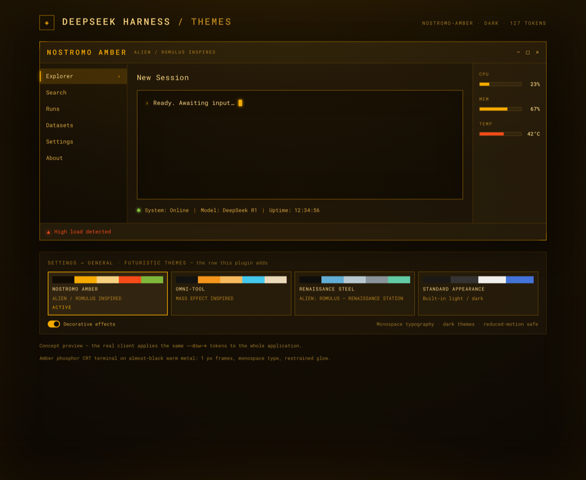
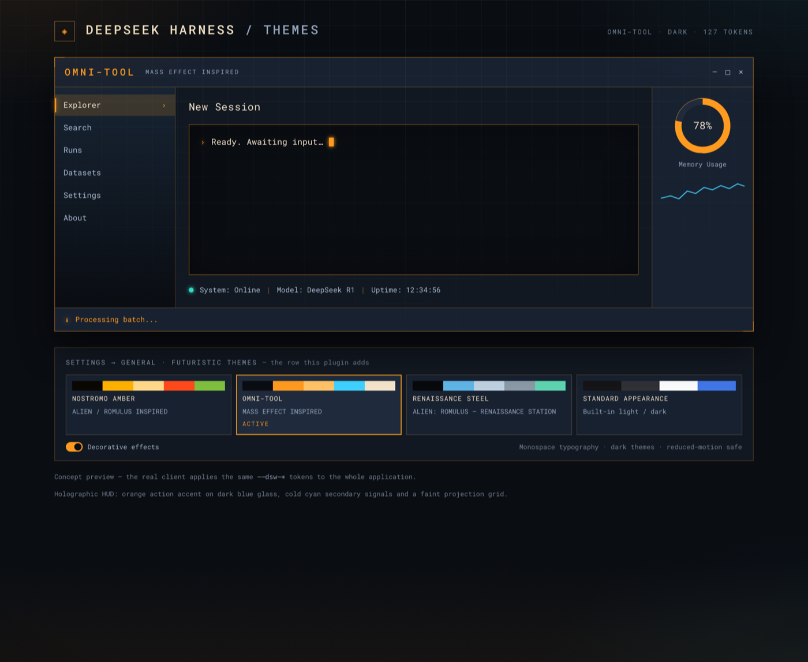
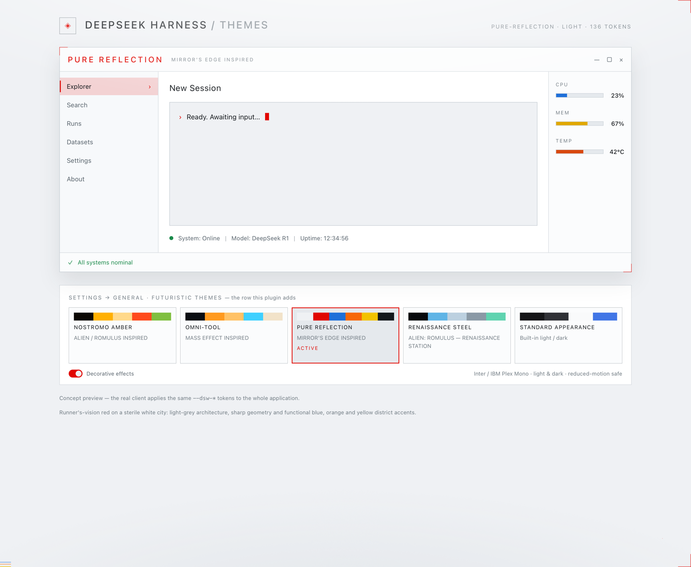
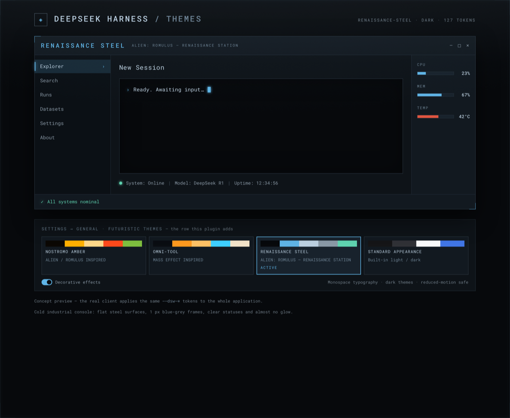
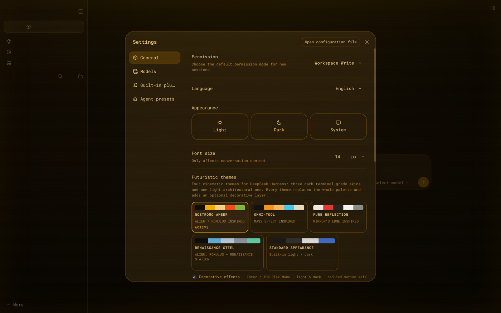
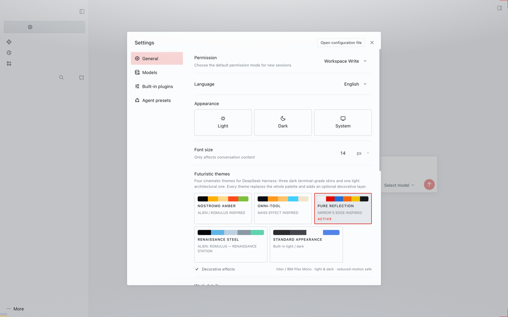
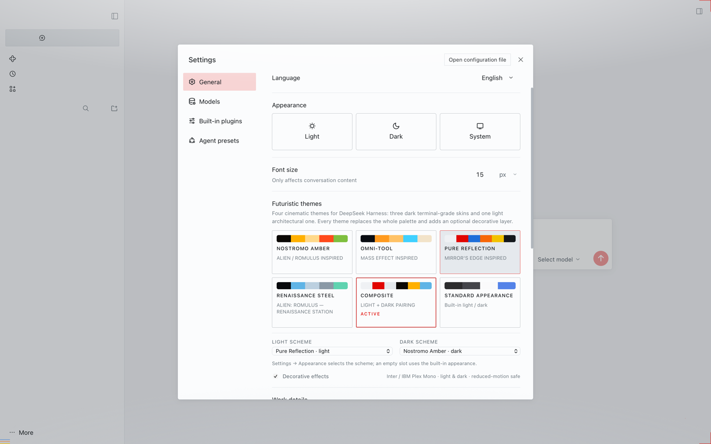
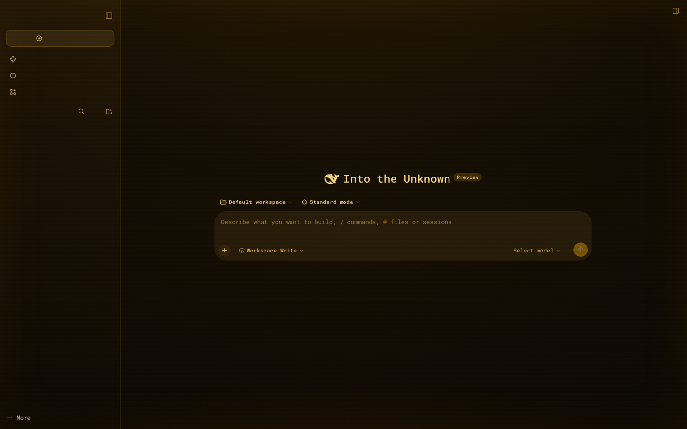
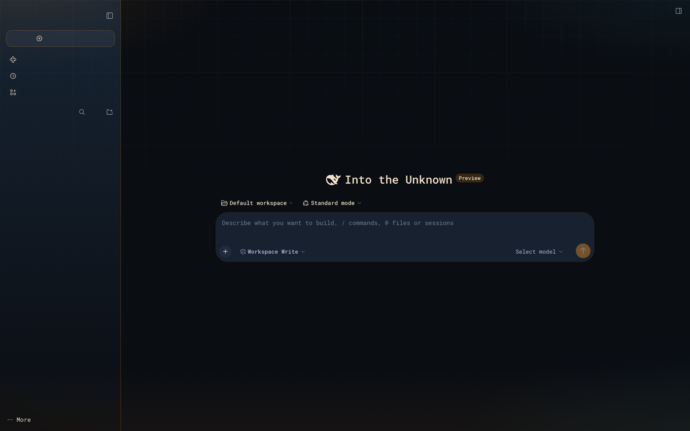
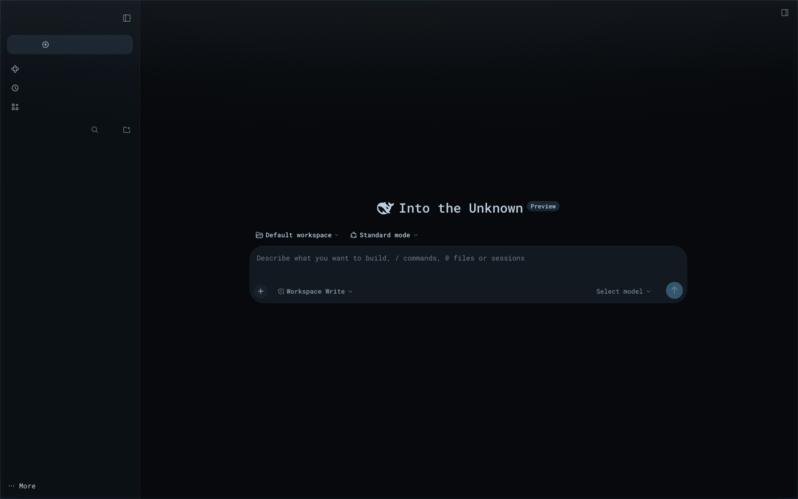

# Futuristic themes for DeepSeek Harness Desktop

Four cinematic themes for **DeepSeek Harness**, built from the four original design briefs and
the concept rendering in [`docs/design-briefs/`](docs/design-briefs/), and delivered as one
installable plugin for DeepSeek Harness Desktop — with a **Composite** mode that pairs a light
and a dark theme with the host's Light / Dark / System appearance.


| Nostromo Amber | Omni-tool | Pure Reflection | Renaissance Steel |
| --- | --- | --- | --- |
|  |  |  |  |

`Settings → General → Futuristic themes` — the row the plugin adds, shown with Nostromo Amber
and Pure Reflection active:

| Nostromo Amber active | Pure Reflection active |
| --- | --- |
|  |  |

Composite mode — one card plus a Light and a Dark scheme selector:



The three dark themes applied to the real app:

| | |
| --- | --- |
|  |  |
|  | |

## What is here

| Path | What it is |
| --- | --- |
| [`dsh-futuristic-themes/`](dsh-futuristic-themes/) | the plugin: four registered themes, one Appearance row with the Composite mode, optional decorative layer |
| [`docs/THEME-CONTRACT.md`](docs/THEME-CONTRACT.md) | authoring contract: palette roles, token derivation, effects rules, preview loop |
| [`docs/INSTALL.md`](docs/INSTALL.md) | Desktop install (plugin manager or manual profile edit) and rollback |
| [`docs/qa/`](docs/qa/) | independent audit harness output + end-to-end verification reports and screenshots |
| [`tools/`](tools/) | WKWebView screenshot harness, independent theme audit, Desktop installer |
| [`docs/design-briefs/`](docs/design-briefs/) | the original design briefs for each theme (Russian, verbatim) + the concept rendering, with English digests |

## The four themes

### Nostromo Amber — retro CRT terminal
*Original brief: [`docs/design-briefs/Nostromo-Amber.md`](docs/design-briefs/Nostromo-Amber.md)*
Almost-black warm metal (`#0B0804`), amber phosphor (`#FFB000` accents, `#FFD98A` text),
1 px amber bezels, monospace type, restrained CRT layer (fine scanlines, phosphor halo, heavy
vignette). Hot `#FF4A1C` warnings and `#7FBF3F` OK states. No glow on long-form text; long
sessions stay readable.

### Omni-tool — holographic HUD
*Original brief: [`docs/design-briefs/Omni-tool.md`](docs/design-briefs/Omni-tool.md)*
Dark blue glass (`#0A0D12`, four glass surface steps), orange action accent (`#FF9A1F`),
cold cyan secondary signals (`#3FD0FF` reserved for informational states), warm `#F2E3C9`
text, thin warm frames. Decorative layer: top-fading cyan/warm projection grid + corner glows.
Orange commands actions; cyan never competes with it.

### Pure Reflection — the City of Glass
*Original brief: [`docs/design-briefs/Pure-Reflection.md`](docs/design-briefs/Pure-Reflection.md) ·
City of Glass addendum: [`docs/design-briefs/Pure-Reflection-Addendum.md`](docs/design-briefs/Pure-Reflection-Addendum.md)*
The light theme of the set: cool white/light-grey architecture (`#EFF1F4` canvas,
`#FFFFFF` panels, `#FBFCFD` dialogs, `#E5E9ED` hover), crisp 1 px cold-grey borders
(`#C9D0D6`), near-black text (`#14181C`) and Runner's-Vision red (`#E10600`, bright `#FF2D2D`)
for navigation, selection, focus and the primary action. Functional district colours:
business blue `#1E6FD9` (links, info, charts, Preview badge), residential orange `#D9480F`
warnings with a brighter `#F76707` signature, technical yellow `#F2C200` / `#E0A800` (charts,
district ticks) and technical green `#1B8A4B` for success; errors use `#B00020`. Sharp 0–4 px
radii, Inter for interface copy, IBM Plex Mono for logs, code, identifiers and metrics.
Decorative layer: overhead daylight, red L-brackets, a red 45° chamfer and a small
blue/orange/yellow district signature — no scanlines, noise, glow or motion.

### Renaissance Steel — cold industrial console
*Original brief: [`docs/design-briefs/Renaissance-Steel.md`](docs/design-briefs/Renaissance-Steel.md)*
Flat steel surfaces (`#07090C` / `#0E1318`), 1 px blue-grey frames (`#26323D`), `#5FB4E6`
accent, `#BCD0E0` text, `#5FD3B0` success, `#E2553F` warning. Almost no glow: a faint overhead
light, a hairline steel bezel and a soft corner vignette — the calmest dark theme of the set.

All four replace the complete semantic `--dsw-*` token set (127 derived tokens each; Pure
Reflection adds nine light/district tokens and registers 136). The three dark themes switch the
interface to a monospace stack; Pure Reflection uses Inter for interface copy, keeps IBM Plex
Mono for technical roles, and sharpens the host radius scale to 0–4 px. The decorative layer
can be disabled in one click and respects `prefers-reduced-motion`. The three dark themes are
dark-only by design; Pure Reflection is the light counterpart.

## Composite mode

A fifth card in the row enables a scheme-aware pairing, without registering a fifth palette:

- **Light scheme** and **Dark scheme** select one of the four themes, or **Built-in**;
- the host **Settings → Appearance** choice drives the mapping: Light uses the Light slot,
  Dark uses the Dark slot, System uses the resolved OS scheme;
- an empty slot uses the built-in appearance for that scheme; if both slots are empty the
  mode turns itself off and Standard appearance takes over;
- clicking a normal theme card (or Standard appearance) leaves Composite and applies that
  choice manually — the mappings stay saved for the next enable;
- the configuration lives in `localStorage`; the durable host preference stays
  `light|dark|system`, so the first paint after a reload already has the right brightness;
- the host's built-in Light/Dark/System cubes do not stay highlighted while a mapped theme is
  active (the host reports the theme id); the Composite card and the two selectors are the
  indicator. Switching may show a short same-scheme frame before the mapped theme lands.

The full test matrix is in [`docs/qa/composite-verification.md`](docs/qa/composite-verification.md).

## How it works

- The plugin registers four theme definitions through the host's official third-party theme
  extension point (`ctx.theme.register`) and contributes one `settings.general.item` row. The
  Composite mode is plugin logic on top of those definitions, not a fifth token set.
- A compact palette (15 roles + optional per-token overrides) is expanded by
  [`scripts/lib/derive.mjs`](dsh-futuristic-themes/scripts/lib/derive.mjs) into the full token
  set, so every theme is complete by construction; the build fails on missing required tokens
  and warns on contrast regressions. The derivation is optimised for dark surfaces, so the
  light theme carries 24 documented overrides: white labels on accent fills and the switch
  thumb, dark tooltips/toasts, a darker error red, a readable caption, a lighter modal scrim,
  and the district tokens the role schema does not expose (blue links/info/charts/business
  badge, yellow technical charts, red selected border/trajectory, amber “done”).
- `ui-theme.preference` only accepts `light|dark|system`, so a theme id is never written there
  (that would crash the next boot with `theme registry lost`). The selected theme lives in
  `localStorage` and is re-applied after the host settings document loads; the durable
  preference stays a built-in value, which keeps the first paint stable.
- With Composite off, choosing the host's built-in Light/Dark/System appearance exits the manual
  theme deliberately and does not resurrect it on reload. With Composite on, the same choice is
  the scheme input and maps to the configured theme (or the built-in appearance for an empty
  slot).
- Nothing host-side is registered: no services, routes, tools or settings namespaces. The
  browser half imports only `react` + the host services it declares. Decorations are a single
  pointer-events-transparent overlay.

## Verification

- **Static audit** (`tools/audit-themes.mjs`, independent of the build): **197/197 checks
  PASS**, 0 failures, 0 warnings — package shape, four theme definitions, 127/127/136/127-token
  derivation, full WCAG contrast matrix, effects-CSS discipline, built-bundle truth.
- **Composite live check** on a private `dsh web` instance (2026-11-13,
  `docs/qa/composite-verification.md`): six-card row and two scheme selectors; host Light →
  Pure Reflection, Dark → Nostromo Amber, System (OS light) → Pure Reflection; a Built-in slot
  falls back to the built-in appearance, both Built-in slots auto-disable Composite; manual
  theme/Standard override; reload persists the dark mapping; a font-size change does not drop
  the mode.
- **End-to-end verification** for the three dark themes on a live `dsh web` instance
  (`docs/qa/verification-report.md`): **8/8 items PASS** — all three themes via the row and via
  persisted reload, live body tokens byte-identical to the derived sets (127/127 × 3),
  persistence with no palette flash, clean exit path, effects switch (pixel-diff confined to
  the overlay), menus/composer/settings regressions clean, live contrast body 12.6–15.4:1 and
  composer 11.2–13.1:1.
- **Pure Reflection live check** on a private `dsh web` instance (2026-11-13,
  `docs/qa/pure-reflection-verification.md`): registers as a light theme with all **136 tokens
  inline** (`color-scheme: light`); the row with the Pure Reflection card active; sharp
  radii confirmed live (`2 px` cards, `4 px` dialog); settings dialog, onboarding dialog and
  empty state checked in English; effects switch verified (overlay gradients on/off, red
  brackets and district ticks at the viewport corners); live contrast 15.77:1 body, 17.37:1
  composer, 16.90:1 sidebar, zero low-contrast text in the DOM scan.
- Two LOW defects found by the dark-theme verifier (boot-restore grace race; missing explicit
  `:focus-visible` ring) are fixed and re-verified; details and evidence (28+ screenshots,
  reproducible step scripts) are in [`docs/qa/`](docs/qa/).

## Install / use

The canonical source is this GitHub repository — the installable package is the
[`dsh-futuristic-themes/`](dsh-futuristic-themes/) folder, and the Desktop profile installs it
straight from GitHub (pinned per commit):

```sh
git clone https://github.com/ihodorchenko/dsh-futuristic-themes.git
cd dsh-futuristic-themes
tools/install-desktop.sh              # install into the Desktop profile
tools/install-desktop.sh --update     # update to the latest GitHub commit
tools/install-desktop.sh --local      # development: link the working copy instead
```

Then open **Settings → General → Futuristic themes**. In-app plugin manager, `dsh web`
installs, the manual profile edit and rollback are documented in
[`docs/INSTALL.md`](docs/INSTALL.md).

## Develop

```sh
NODE="$HOME/.dsh/dsh-runtimes/dsh-primary-runtime/dependencies/node/bin/node"
cd dsh-futuristic-themes
$NODE scripts/build.mjs          # derive tokens from src/themes/*.json → lib/client.js
$NODE scripts/build.mjs --check  # validate only
$NODE scripts/preview.mjs        # build/preview.html + one mock per theme
$NODE ../tools/audit-themes.mjs  # independent 197-check audit
```

`lib/client.js` is committed (no build step on the user's machine); the source template and
per-theme data are in `src/`.

## Compatibility

DeepSeek Harness Desktop **0.2.1-rc.5** and the matching `dsh web`; also smoke-tested on
Desktop 0.2.2-rc.2 and 0.2.2-rc.3. Requires the host theme extension point
(`@deepseek-ai/dsh-client-ui-theme`) and the `settings.general.item` slot. Tested in this
environment only.

## License

[MIT](LICENSE) © 2026 Ihar Khadorchanka.

The original design briefs in [`docs/design-briefs/`](docs/design-briefs/) and the concept
rendering are part of this repository and covered by the same license.
